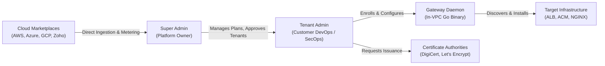
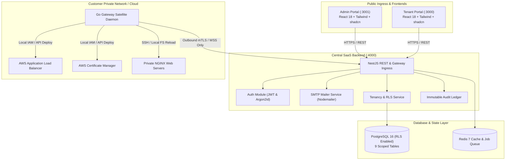
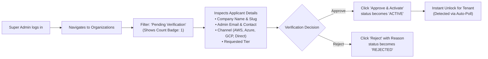
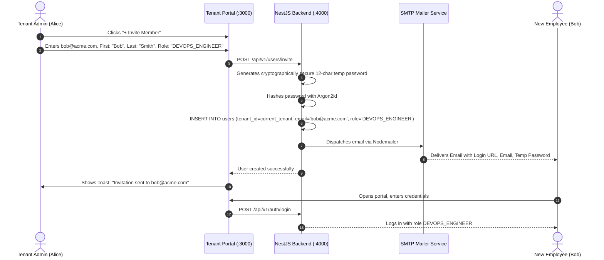
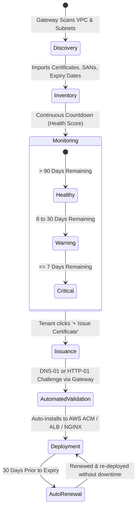
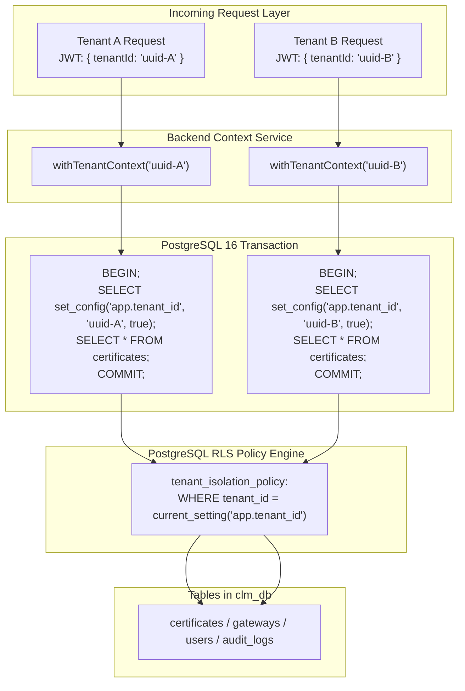
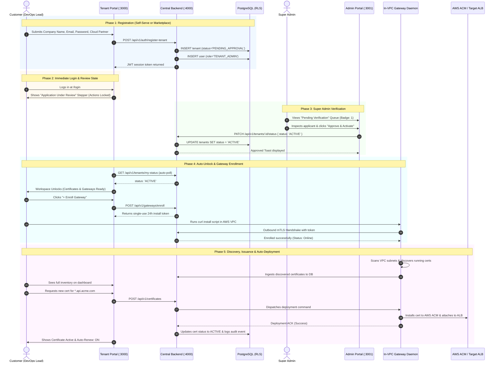

# CLM Platform: Complete End-to-End Application Workflow Specification

> **Document Type:** Production Architecture & Workflow Specification  
> **Platform Name:** CLM Platform (Certificate Lifecycle Management)  
> **Target Audience:** DevOps Leads, Cloud Architects, Super Admins, Security Compliance Auditors, Marketplace Reviewers  
> **Revision:** 2.1 (MVP Launch Complete)  
> **Date:** November 10, 2026

---

## Table of Contents
1. [Executive Summary & Core Problem Statement](#1-executive-summary--core-problem-statement)
2. [Platform Actors & RBAC Personas](#2-platform-actors--rbac-personas)
3. [High-Level System Architecture](#3-high-level-system-architecture)
4. [Stage 1: Multi-Channel Onboarding & Ingestion](#4-stage-1-multi-channel-onboarding--ingestion)
5. [Stage 2: Gated Security Verification & Immediate Applicant Login](#5-stage-2-gated-security-verification--immediate-applicant-login)
6. [Stage 3: Super Admin Plan Customization & Verification Queue](#6-stage-3-super-admin-plan-customization--verification-queue)
7. [Stage 4: Multi-Gateway Fleet & Cloud Access Security Model](#7-stage-4-multi-gateway-fleet--cloud-access-security-model)
8. [Stage 5: Tenant In-Portal Team RBAC Management & Automated SMTP Mailer](#8-stage-5-tenant-in-portal-team-rbac-management--automated-smtp-mailer)
9. [Stage 6: Day-to-Day Certificate Lifecycle Operations](#9-stage-6-day-to-day-certificate-lifecycle-operations)
10. [Multi-Tenant Data Isolation & Security Architecture (PostgreSQL RLS)](#10-multi-tenant-data-isolation--security-architecture-postgresql-rls)
11. [End-to-End Sequence Diagram (Start to Finish)](#11-end-to-end-sequence-diagram-start-to-finish)
12. [Summary Checklist for External Reviewers](#12-summary-checklist-for-external-reviewers)

---

## 1. Executive Summary & Core Problem Statement

### The Problem in Enterprise Infrastructure
Every modern business relies on hundreds or thousands of SSL/TLS certificates across domains, APIs, load balancers, Kubernetes clusters, and internal services. 
* **Catastrophic Outages:** When an SSL certificate unexpectedly expires, websites go down, mobile apps break, APIs reject traffic, and customer trust is damaged.
* **Spreadsheet Chaos:** Most DevOps teams still track certificate expiration dates in spreadsheets or ad-hoc calendars.
* **Manual Deployment Risk:** Manually copying private keys and `.crt` files onto servers leads to human errors and security leaks.
* **Firewalled Environments:** Internal web servers and private VPCs cannot be reached directly by cloud scanners.

### The Solution: CLM Platform
The **CLM Platform** provides an automated, zero-trust control plane that:
1. **Discovers** all existing SSL certificates across public domains, private VPCs, and on-prem networks.
2. **Monitors** certificate health, algorithm strength, and expiration countdowns in real time.
3. **Automates Renewal** before certificates can expire.
4. **Auto-Deploys** certificates directly into target infrastructure (AWS ACM, AWS ALB, NGINX, Apache, Cloudflare) with zero downtime.
5. **Enforces Multi-Tenant Isolation** via database-level Row-Level Security (RLS).
6. **Integrates with Cloud Marketplaces** (AWS, Azure, Google Cloud, Zoho) for frictionless procurement.
7. **Empowers In-Portal RBAC** allowing Tenant Admins to invite and delegate roles to their employees with automated SMTP credentials delivery.

---

## 2. Platform Actors & RBAC Personas



| Persona | Scope | What They Can Do | What They Are Blocked From Doing |
| :--- | :--- | :--- | :--- |
| **`SUPER_ADMIN`** | Platform | Full platform authority: Approves new tenant applicants, manages dynamic subscription plans, configures effective dates, monitors global audits, and views multi-marketplace billing. | Cannot see tenant private keys or decrypt tenant certificates. |
| **`TENANT_ADMIN`** | Organization | Organization owner: Full operational authority over their workspace. Invites employees, assigns RBAC roles, issues certificates, enrolls gateways. | Cannot see or modify data of other tenants (enforced by RLS). |
| **`SECURITY_LEAD`** | Organization | Policy & Cryptography: Sets approved CAs (DigiCert, Let's Encrypt), enforces minimum key strength (RSA 2048, ECC P-256), approves revocations. | Cannot invite/delete users or alter company billing tier. |
| **`DEVOPS_ENGINEER`** | Organization | Daily Operations: Issues/renews certificates, runs gateway install scripts in VPCs, deploys certificates to ALBs and NGINX servers. | Cannot change company security policies or invite users. |
| **`AUDITOR`** | Organization | Compliance Reviewer: Read-only access to immutable audit logs, certificate inventory, and export reports for SOC 2 / ISO 27001 audits. | **Zero write permissions**: Cannot issue, renew, deploy, or delete. |
| **`READ_ONLY`** | Organization | Basic Observer: Can only view dashboards and expiration countdowns. | All create, edit, and delete action buttons are hidden. |

---

## 3. High-Level System Architecture



---

## 4. Stage 1: Multi-Channel Onboarding & Ingestion

Tenants can enter the platform through **5 distinct channels**:

```mermaid
flowchart TD
    subgraph Channel1["1. Direct Web Signup"]
        A1["Customer visits /signup"]
        A2["Enters Company Name, Work Email, Password"]
    end

    subgraph Channel2["2. AWS Marketplace"]
        B1["Customer clicks 'Subscribe' on AWS"]
        B2["Redirects with x-amzn-marketplace-token"]
        B3["Backend calls AWS ResolveCustomer API"]
    end

    subgraph Channel3["3. Azure Marketplace"]
        C1["Customer buys SaaS Contract on Azure"]
        C2["Azure SaaS Fulfillment v2 Webhook"]
        C3["Resolves Subscription ID & Entitlement"]
    end

    subgraph Channel4["4. Google Cloud Marketplace (GCP)"]
        D1["Customer buys on GCP Marketplace"]
        D2["GCP Procurement & Entitlement API"]
        D3["Resolves Cloud Billing Account ID"]
    end

    subgraph Channel5["5. Zoho Marketplace"]
        E1["Customer installs Zoho CLM Extension"]
        E2["Zoho OAuth Webhook triggers Onboarding"]
    end

    A2 --> PROVISION["Unified Provisioning Engine<br/>POST /api/v1/auth/register-tenant"]
    B3 --> PROVISION
    C3 --> PROVISION
    D3 --> PROVISION
    E2 --> PROVISION
```



### What the Provisioning Engine Does Automatically:
1. **Generates Tenant Workspace:** Creates a row in `tenants` table with unique UUID `id`, URL-friendly `slug`, requested `tier`, and initial `status = 'PENDING_APPROVAL'`.
2. **Generates Admin Account:** Inserts initial user into `users` table with `role = 'TENANT_ADMIN'`, `status = 'ACTIVE'`, and Argon2id password hash.
3. **Attaches Marketplace Metadata:** Saves `aws_account_id`, `aws_customer_identifier`, Azure subscription ID, or GCP billing identifier.
4. **Appends Audit Event:** Records `TENANT_REGISTERED` in the immutable audit log.
5. **Issues Immediate JWT Session:** Logs the user in on the spot so they don't have to wait for an email link.

---

## 5. Stage 2: Gated Security Verification & Immediate Applicant Login

### Why the Security Gate is Mandatory
Allowing unverified users to immediately issue SSL certificates or deploy gateway daemons creates severe security and legal liability risks:
* Phishing attacks and fraudulent domain impersonation.
* Misuse of Certificate Authority (Let's Encrypt / DigiCert) rate limits.
* Unauthorized network scanning.

### The Applicant's Login Experience (Status: `PENDING_APPROVAL`)
1. **Immediate Access:** When the customer registers or visits `/login`, they can log in immediately with their email and password.
2. **Authenticated Session Header:** The top header displays their name (e.g. `Alice Vance`), company name, and a status badge: `Under Review`.
3. **Interactive "Review in Progress" Dashboard:**
   * **Step 1: Account Created** `[Complete ✓]`
   * **Step 2: Security & Domain Verification** `[In Progress ⟳]`
   * **Step 3: Certificate Issuance & Gateway Privileges** `[Pending Unlock 🔒]`
4. **Transparency & ETA:** Displays clear text:
   > *"Thank you for registering [Company]. Our compliance team is verifying your business domain to prevent unauthorized certificate issuance. Estimated review time: 15–30 minutes."*
5. **Status Auto-Polling:** The page automatically checks `/api/v1/tenants/my-status` every 15 seconds (with a manual **"Refresh Status"** button).
6. **Feature Lock:** Action buttons (`+ Issue Certificate`, `+ Enroll Gateway`) are locked with clear informational tooltips.

---

## 6. Stage 3: Super Admin Plan Customization & Verification Queue

In the **Super Admin Portal (`:3001`)**:



### Dynamic Plan Management & Customization
Super Admins are **not** locked into static plans. Through the **Plan Customizer**, Super Admins can:
1. **Create & Edit Subscription Plans:**
   * Plan Name (`Starter`, `Professional`, `Enterprise`, `PayGO`)
   * Quota Limits: `Max Certificates` (e.g. 50, 500, Unlimited), `Max Gateways` (e.g. 2, 5, 20)
   * Feature Toggles: Auto-Renewal, Custom Private CA, Multi-Cloud Deploy targets, SLA tier.
2. **Handle Plan Changes with "Effective Dates":**
   * When modifying an existing plan, the admin can set an **Effective Date** (e.g., `2026-12-01` or next billing cycle).
   * **Grandfathering:** Existing active subscribers remain on their current quota/price until their renewal date.
   * **New Subscribers:** Immediately receive the updated limits.

---

## 7. Stage 4: Multi-Gateway Fleet & Cloud Access Security Model

### Why Do Tenants Need Multiple Gateways?
Enterprise networks are segmented into isolated security zones. A single cloud connection cannot span multiple physical networks or private VPCs.
* **Gateway 1:** Installed in `aws-us-east-1-production-vpc`
* **Gateway 2:** Installed in `aws-eu-central-1-staging-vpc`
* **Gateway 3:** Installed in `on-prem-datacenter-frankfurt`
* **Gateway 4:** Installed in `gcp-asia-south1-k8s-cluster`

Each gateway reports its own IP, version, uptime, and discovered assets to the tenant's single pane of glass.

---

### How Does the Platform Access the Customer's Cloud? (Deep Dive)

The platform supports **two enterprise access models**:

```mermaid
flowchart TD
    subgraph Model1["Model 1: In-VPC Gateway Daemon (Zero-Trust Agent) — RECOMMENDED"]
        direction TB
        GW["Local Go Gateway Daemon<br/>(Runs on EC2, EKS, or Linux VM)"]
        IAM["EC2 IAM Instance Profile / Pod IRSA<br/>(Attached Locally inside customer account)"]
        ALB["Customer Private ALB / NGINX"]
        
        GW -->|Assumes local role automatically| IAM
        GW -->|Local network reload & deploy| ALB
        GW -->|Outbound mTLS only<br/>(Port 443)| CLOUD["Our SaaS Control Plane"]
    end

    subgraph Model2["Model 2: Agentless Cross-Account IAM Role (Cloud-to-Cloud)"]
        direction TB
        SaaSBackend["Our SaaS Central Cloud"]
        Trust["AWS sts:AssumeRole with ExternalId"]
        CustCloud["Customer AWS Cloud (ACM / Route53)"]
        
        SaaSBackend -->|Cross-Account API Call| Trust
        Trust --> CustCloud
    end
```

#### Comparison of the Two Cloud Access Models:

| Security Criteria | Model 1: In-VPC Gateway Daemon | Model 2: Agentless Cross-Account IAM |
| :--- | :--- | :--- |
| **Where it runs** | Customer's private VPC or on-prem server | Directly from our SaaS cloud |
| **Firewall Ports** | **Zero open inbound ports** (outbound mTLS only) | N/A (cloud-to-cloud) |
| **Cloud Credentials** | **Never shared with us**; uses local IAM instance profile | Customer grants `sts:AssumeRole` with unique `ExternalId` |
| **Private NGINX / K8s** | Fully supported (inside the same local network) | Not possible (cannot penetrate private VPCs) |
| **Best For** | Internal services, private VPCs, hybrid cloud | Public DNS and public AWS ACM load balancers |

---

## 8. Stage 5: Tenant In-Portal Team RBAC Management & Automated SMTP Mailer

Inside the **Tenant Customer Portal (`:3000`)**, under **Settings $\rightarrow$ Team & Members**:



### The Automated Invitation Email Template
When an employee is invited, the SMTP service dispatches a responsive HTML email:
```text
From: CertFlow CLM Support <no-reply@clm-platform.com>
To: bob@acme.com
Subject: Welcome to CertFlow CLM — Your Account Credentials

Hello Bob,

Alice Vance has invited you to join the Acme Corp team on CertFlow CLM with the role: DevOps Engineer.

Here are your account credentials:
* Portal URL: https://app.clm-platform.com/login (or http://localhost:3000)
* Email: bob@acme.com
* Temporary Password: [SecureRandomPassword123!]

Please log in and update your password upon your first session.
```

### In-Portal User Actions for Tenant Admin:
1. **Invite Team Member:** Provide email, name, and choose from `SECURITY_LEAD`, `DEVOPS_ENGINEER`, `AUDITOR`, `READ_ONLY`.
2. **Change Role:** Promote or change permissions instantly (e.g. `READ_ONLY` $\rightarrow$ `DEVOPS_ENGINEER`).
3. **Deactivate User:** Suspend an employee who leaves the company without deleting their audit history.
4. **Row-Level Security Guarantee:** Tenant Admins can only see and manage users with their own `tenant_id`.

---

## 9. Stage 6: Day-to-Day Certificate Lifecycle Operations

Once activated, the tenant manages their full certificate lifecycle in **6 steps**:



1. **Automated Discovery:** The connected Gateway sweeps local IP ranges, TLS SNI endpoints, and web server configuration files, syncing all existing certificates into the dashboard.
2. **Real-Time Inventory & Search:** Filter by domain name, issuer (DigiCert, Let's Encrypt), algorithm (`RSA 2048`, `ECC P-256`), or status (`Active`, `Expiring`, `Critical`).
3. **One-Click Issuance:** Request a new certificate by providing domains and SANs. The Gateway completes the DNS challenge automatically.
4. **Automated Zero-Downtime Deployment:** Pushes signed certificates to AWS ACM, attaches to Application Load Balancers, or reloads NGINX daemons.
5. **Continuous Alerts:** Proactive notifications fire to Slack, Microsoft Teams, or Webhooks at 30, 15, and 7 days before expiration.
6. **Immutable Audit Trail:** Every issuance, renewal, deployment, and revocation is recorded in the append-only audit ledger for compliance (SOC 2, ISO 27001).

---

## 10. Multi-Tenant Data Isolation & Security Architecture (PostgreSQL RLS)

Data isolation is guaranteed at the **database kernel level**, not just in application code:



### Guarantees:
* **No Cross-Tenant Leaks:** Even if an engineer writes a raw `SELECT * FROM certificates;` query without a `WHERE` clause, PostgreSQL automatically filters out all records not belonging to `app.tenant_id`.
* **Zero Trust:** Even if Tenant A knows the exact certificate UUID of Tenant B, the database returns `0 rows` or throws a permission violation.

---

## 11. End-to-End Sequence Diagram (Start to Finish)



---

## 12. Summary Checklist for External Reviewers

| Architectural Question | Platform Implementation | Verification / Proof |
| :--- | :--- | :--- |
| **Is multi-tenancy safe?** | Enforced at database engine level via PostgreSQL Row-Level Security (RLS). | `01-init-rls.sql` enforces `tenant_isolation_policy` across all 9 tables. |
| **Can customers log in while pending?** | Yes. User account is active immediately; tenant workspace shows live verification stepper. | Tenant portal displays interactive review screen with status auto-poll. |
| **Can unverified users issue certs?** | No. Issuance and token generation are strictly gated until Super Admin approves. | Backend API rejects issuance requests for non-`ACTIVE` tenants. |
| **Does it support multiple marketplaces?** | Yes. Architecture handles AWS Marketplace, Azure Marketplace, GCP, and Zoho. | Multi-Marketplace Hub in Admin Portal with metering gauges. |
| **Can tenants add multiple gateways?** | Yes. Scalable fleet supporting separate gateways per VPC, region, or on-prem DC. | Gateway tokens support multi-agent enrollment with unique IDs. |
| **Are customer AWS credentials safe?** | 100%. In-VPC Gateway uses local EC2/EKS IAM roles; customer never shares secret keys. | Gateway establishes outbound-only mTLS connection to SaaS. |
| **Can tenants manage RBAC and invite members?** | Yes. In-portal team management with automatic SMTP password generation and delivery. | Tenant Admin invites employee $\rightarrow$ SMTP sends credentials $\rightarrow$ Employee logs in. |
