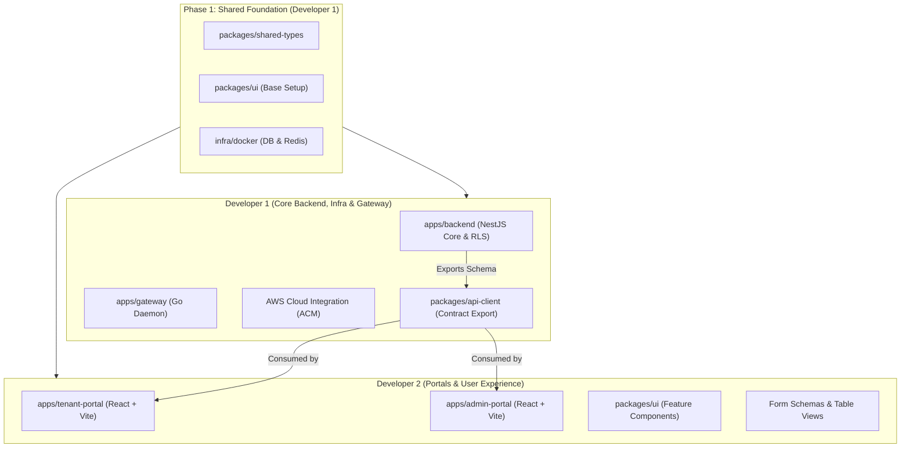

# CLM Platform: Two-Developer Implementation Plan

This document outlines the development split, module ownership, milestone checkpoints, and handoff strategy for **Developer 1** and **Developer 2**.

---

## 1. Architectural Responsibility Split

The monorepo structure allows clean domain boundaries so both developers can work in parallel without merge conflicts or overlapping responsibilities:

| Area | Developer 1 (Lead & Backend) | Developer 2 (Frontend & UX) |
|---|---|---|
| **Primary Workspaces** | `apps/backend` `apps/gateway` `infra/docker` `packages/proto` | `apps/tenant-portal` `apps/admin-portal` `packages/ui` `packages/api-client` (UI consumption) |
| **Domain Focus** | Database RLS, NestJS controllers/services/repositories, background jobs, mTLS gateway daemon, AWS deployment APIs. | Page composition, interactive tables (TanStack Table), form handling (`react-hook-form` + `zod`), dialogs, dashboard stat cards. |
| **Local Environment** | Runs Docker (PostgreSQL, Redis) + NestJS + Go compiler. | Runs lightweight Vite dev server (`pnpm --filter tenant-portal dev`), UI component development with mock data or local backend. |

---

## 2. Phase A: Initial Foundation (Built by Developer 1 First)

Before sharing the repository with Developer 2, Developer 1 builds the base scaffold so Developer 2 can clone, run `pnpm install`, and immediately start coding without environment blockers.

### Developer 1 Foundation Checklist:
- [x] Monorepo scaffold (`pnpm-workspace.yaml`, `turbo.json`, `package.json`).
- [ ] Root TypeScript and ESLint configuration (`packages/config`).
- [ ] Base data types and enums (`packages/shared-types`): `Role`, `CertStatus`, `DeployTargetType`, `Tenant`.
- [ ] Docker Compose for local PostgreSQL and Redis (`infra/docker`).
- [ ] Base NestJS backend application with Swagger/OpenAPI enabled (`apps/backend`).
- [ ] Base Vite + React shells for both portals with Tailwind and shadcn/ui configured (`apps/tenant-portal`, `apps/admin-portal`).
- [ ] Mock API / MSW / API client scaffold (`packages/api-client`).

---

## 3. The Handoff Milestone: When to Share Code with Developer 2

**Exact Moment to Share:**  
As soon as Developer 1 completes **Phase A** and verifies that:
1. `pnpm install` succeeds cleanly.
2. Running `pnpm --filter tenant-portal dev` opens the portal shell with working navigation.
3. Base types in `packages/shared-types` are exported and accessible.

At this point, Developer 1 commits to `main`, pushes to the shared repository, and Developer 2 clones the repo and begins **Phase B**.

---

## 4. Phase B: Parallel Development Tracks

### 🧑‍💻 Developer 1: Backend Services & Gateway Engine

Developer 1 works primarily in `apps/backend` and `apps/gateway`.

#### Milestone 1: Multi-Tenancy & Auth Core
* Implement PostgreSQL schema with `tenant_id` on all tables.
* Implement Row-Level Security (RLS) helper (`SET LOCAL app.tenant_id = :id`).
* Build NestJS `TenantsModule` and `UsersModule` with Argon2 password hashing.
* Implement JWT strategy, `JwtAuthGuard`, and `@Roles()` decorator.

#### Milestone 2: Gateway Engine & Ingress
* Implement Gateway enrollment token generation in `GatewaysModule`.
* Implement Gateway ingress controller handling heartbeats and command polling.
* Build the Go gateway client daemon (`apps/gateway`) that establishes outbound HTTPS connections and reports heartbeats.

#### Milestone 3: Discovery & AWS ACM Deployer
* Build discovery command handler in Go gateway (DNS / TLS SNI scanner).
* Build AWS ACM deployment executor in Go gateway using AWS SDK.
* Implement append-only `AuditLogModule` recording every action.

---

### 🎨 Developer 2: Customer Portals & User Experience

Developer 2 works primarily in `apps/tenant-portal`, `apps/admin-portal`, and `packages/ui`.  
*(Can develop using the API client with type-safe mock data or the local backend).*

#### Milestone 1: Design System & Layout
* Setup shared sidebar navigation, header, theme toggle (dark/light), and user avatar menu in `packages/ui`.
* Build standard layouts: `AppLayout` (sidebar + topbar) and `AuthLayout` (centered card for login).
* Build reusable status badges (`Active`, `Expiring Soon`, `Expired`, `Revoked`).

#### Milestone 2: Tenant Portal Core Screens (`apps/tenant-portal`)
* **Dashboard Screen:** 
  * Stat cards: Total Certificates, Expiring in 30 Days, Active Gateways, Health Score.
  * Recent activity feed and quick action buttons.
* **Certificate Inventory Screen:**
  * Interactive data table with search, domain filter, and status filter.
  * Columns: Domain, Status Badge, Issuer, Expiry Date, Days Remaining countdown, Actions.
  * Detail modal/drawer showing SANs, Key Algorithm, and deployment history.
* **Gateway Fleet Screen:**
  * Gateway cards showing status (`online` / `offline`), IP, version, last heartbeat.
  * `+ Deploy Gateway` modal with single-use token display card and copy button.

#### Milestone 3: Admin Portal Core Screens (`apps/admin-portal`)
* **Tenant Management Screen:** Table of client organizations, subscription plan, active gateway count, and status toggle.
* **Global Audit Screen:** Time-filtered table of system-wide actions for compliance reviews.

---

## 5. Integration Checkpoints & Testing

To ensure seamless integration between Developer 1 and Developer 2:

| Checkpoint | What is Integrated | Verification Method |
| :---: | :--- | :--- |
| **Checkpoint 1** | **Auth & Shell** | Developer 2 connects portal login forms to Developer 1's `/api/v1/auth/login` endpoint. |
| **Checkpoint 2** | **Fleet & Tokens** | Developer 2's `+ Deploy Gateway` modal triggers Developer 1's gateway registration endpoint and displays the generated token. |
| **Checkpoint 3** | **Inventory Live Feed** | Developer 2's certificate table renders live certificates discovered by Developer 1's gateway scanner. |
| **Checkpoint 4** | **Deployment Trigger** | Developer 2's Deploy dialog sends deployment request to Developer 1's backend, triggering live AWS ACM deployment. |

---

## 6. Git Workflow Rules

1. **Main Branch is Protected:** Never push directly to `main`.
2. **Branch Naming:**
   * Developer 1 branches: `feat/backend-<feature-name>` or `feat/gateway-<feature-name>`
   * Developer 2 branches: `feat/portal-<feature-name>` or `feat/ui-<feature-name>`
3. **Automated Reviews:** CodeRabbit reviews every pull request against the rules defined in `.coderabbit.yaml`.
4. **Clean Merge Strategy:** Rebase or Squash-and-merge into `main` after integration checkpoints pass.
