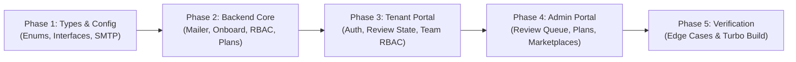
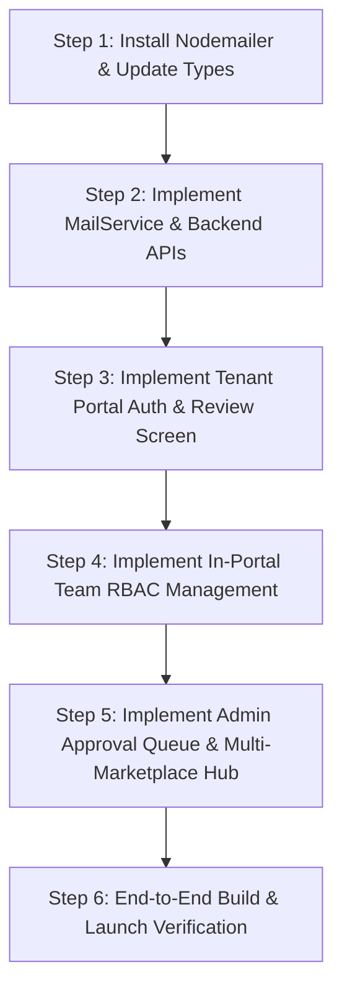

# CLM Platform: Complete Master Implementation Plan
> **Execution Date:** November 10, 2026  
> **Target:** Complete Full Implementation & MVP Production Launch Today  
> **Status:** Ready for Phased Execution

---

## 1. Plan Overview & Today's Objectives

This master plan covers the **complete end-to-end implementation** of all architectural components discussed for today's launch without missing any functional or operational details.

---

## 2. Phase-by-Phase Execution Breakdown

### Phase 1: Shared Foundation, Models & Types (`packages/shared-types`)
* **Goal:** Establish all shared data contracts so frontends and backend share identical interfaces.
* **Tasks:**
  1. **Update `TenantStatus` Enum:**
     * Add `PENDING_APPROVAL = 'PENDING_APPROVAL'`
     * Add `REJECTED = 'REJECTED'`
  2. **Add `CloudMarketplace` Enum:**
     * `DIRECT = 'DIRECT'`
     * `AWS_MARKETPLACE = 'AWS_MARKETPLACE'`
     * `AZURE_MARKETPLACE = 'AZURE_MARKETPLACE'`
     * `GCP_MARKETPLACE = 'GCP_MARKETPLACE'`
     * `ZOHO_MARKETPLACE = 'ZOHO_MARKETPLACE'`
  3. **Update `Tenant` Interface:**
     * Add `marketplaceProvider?: CloudMarketplace`
     * Add `effectivePlanDate?: string`
  4. **Create Subscription Plan Interfaces:**
     * `PlanDefinition`: `id`, `tier`, `name`, `maxCertificates`, `maxGateways`, `priceMonthly`, `features`, `effectiveDate`.
  5. **Create Team & RBAC DTOs:**
     * `InviteMemberRequest`: `email`, `firstName`, `lastName`, `role`.
     * `UpdateMemberRoleRequest`: `userId`, `role`.
     * `MemberListItem`: User with role, status, last login, and tenant metadata.
  6. **Build & Verify:** Run `pnpm --filter @clm/shared-types build`.

---

### Phase 2: Backend Architecture & Services (`apps/backend`)
* **Goal:** Implement the business logic, API endpoints, and mailer infrastructure.
* **Tasks:**
  1. **Automated SMTP Mailer Module (`apps/backend/src/shared/mail`):**
     * Install `nodemailer` and `@types/nodemailer`.
     * Build `MailService`:
       * Connects to SMTP host (`SMTP_HOST`, `SMTP_PORT`, `SMTP_USER`, `SMTP_PASS`).
       * If SMTP credentials are dummy/local, logs the email and temporary credentials to console with a formatted box so development is never blocked.
       * `sendWelcomeCredentials(email, name, role, tempPassword, portalUrl)`.
  2. **Tenant Onboarding & Security Gating:**
     * In `AuthController` & `TenantsController`:
       * `POST /api/v1/auth/register-tenant`:
         * Accepts `organizationName`, `adminEmail`, `password`, `adminFirstName`, `adminLastName`, `marketplaceProvider`.
         * Creates tenant with status `PENDING_APPROVAL`.
         * Creates initial admin user with role `TENANT_ADMIN`.
         * Dispatches audit log `TENANT_REGISTERED`.
         * Issues JWT session token immediately so user lands logged in.
       * `GET /api/v1/tenants/my-status`:
         * Scoped endpoint returning the authenticated tenant's current verification status (`PENDING_APPROVAL`, `ACTIVE`, `REJECTED`, `SUSPENDED`).
       * `PATCH /api/v1/tenants/:id/status`:
         * Super-admin only endpoint to `APPROVE` (`status = 'ACTIVE'`) or `REJECT` (`status = 'REJECTED'`).
  3. **In-Portal Team & RBAC Management:**
     * In `UsersController` & `UsersService`:
       * `POST /api/v1/users/invite`:
         * Guarded by `Roles(Role.TENANT_ADMIN)`.
         * Generates secure 12-character random temporary password.
         * Hashes password with Argon2id.
         * Inserts into `users` under current `app.tenant_id`.
         * Dispatches automated SMTP credentials email.
         * Returns safe user object without password hash.
       * `GET /api/v1/users`:
         * Lists all employees belonging to the caller's tenant (RLS enforced).
       * `PATCH /api/v1/users/:id/role`:
         * Allows `TENANT_ADMIN` to modify an employee's role (`SECURITY_LEAD`, `DEVOPS_ENGINEER`, `AUDITOR`, `READ_ONLY`).
       * `PATCH /api/v1/users/:id/status`:
         * Allows `TENANT_ADMIN` to activate or deactivate an employee.
  4. **Dynamic Plans & Effective Dates API:**
     * `GET /api/v1/plans`: Returns all system subscription plans.
     * `PATCH /api/v1/plans/:tier`: Updates quotas, pricing, and scheduled `effectiveDate`.
  5. **Backend Compilation Check:** Run `pnpm --filter @clm/backend build`.

---

### Phase 3: Tenant Customer Portal (`apps/tenant-portal`)
* **Goal:** Build the complete customer journey from login/signup to gated review and in-portal RBAC.
* **Tasks:**
  1. **Dynamic Authentication Context (`App.tsx`):**
     * Replace hardcoded demo tenant ID with dynamic authentication state stored in `localStorage` or session:
       * Stored `clm_token`, `clm_user`, `clm_tenant`.
     * Provide a **Sign In / Sign Up Modal** accessible via top-bar profile or unauthenticated landing:
       * Toggle between "Sign In" and "Create Organization Account".
       * Sign up form collects: Company Name, Work Email, First/Last Name, Password, Cloud Marketplace Source.
  2. **Gated State: "Security Verification in Progress" Screen:**
     * If authenticated tenant status is `PENDING_APPROVAL`:
       * Render the modern review dashboard:
         * Top Header shows applicant's name and **"Account Under Review"** badge.
         * 3-Step Interactive Stepper:
           1. Account Registered `(Complete ✓)`
           2. Security & Domain Compliance `(In Progress ⟳)`
           3. Issuance & Gateway Privileges `(Pending Unlock 🔒)`
         * Informational review card with turnaround estimate (15–30 mins).
         * **"Check Status" button** with rotating refresh spinner.
         * Background auto-polling (polls `/api/v1/tenants/my-status` every 15s).
         * As soon as status flips to `ACTIVE`, workspace automatically transitions to the live dashboard with a congratulatory toast.
       * If status is `REJECTED`: Shows clean rejection banner with support contact action.
  3. **Settings $\rightarrow$ Team & RBAC Management:**
     * In the Settings tab, add a dedicated **"Team & RBAC"** view:
       * Table of all invited employees: Name, Email, Role badge (`TENANT_ADMIN`, `SECURITY_LEAD`, `DEVOPS_ENGINEER`, `AUDITOR`, `READ_ONLY`), Status (`Active` / `Suspended`), Last Login.
       * **"+ Invite Member" Modal:**
         * Email, First Name, Last Name.
         * Role dropdown with description of permissions for each role.
         * Action triggers API call and displays toast: *"Invitation with temporary credentials sent to [email]"*.
       * **Role Change & Deactivate Dropdowns:**
         * Inline role switcher to promote/demote employees.
         * Deactivate button with confirmation dialog.
  4. **Multi-Gateway Fleet UI:**
     * Gateways tab displays active gateways with health indicators, IP, supported targets, and heartbeat.
     * "+ Enroll Gateway" modal generates single-use 24h token with one-click copy command.
  5. **Compile Check:** Run `pnpm --filter tenant-portal build`.

---

### Phase 4: Super Admin Portal (`apps/admin-portal`)
* **Goal:** Give Super Admins verification control, dynamic plan customization, and multi-cloud marketplace visibility.
* **Tasks:**
  1. **Verification Review Queue (Organizations Tab):**
     * Add sub-navigation filters:
       * `All Organizations`
       * `Active`
       * `Pending Verification (Badge Count)`
       * `Suspended`
     * On pending organization cards:
       * Display originating channel tag (`Direct`, `AWS Marketplace`, `Azure`, `GCP`, `Zoho`).
       * Display contact email and requested plan.
       * **"Approve & Activate" Button (Green Gradient):** Calls `PATCH /api/v1/tenants/:id/status` $\rightarrow$ marks `ACTIVE`, logs audit event, triggers success toast.
       * **"Reject" Button (Red Outline):** Opens rejection reason modal $\rightarrow$ marks `REJECTED`.
  2. **Dynamic Plan Customizer with Effective Dates:**
     * In the Plan management modal/tab:
       * Customize quotas: `Max Certificates` (slider/input), `Max Gateways` (slider/input).
       * Set **Effective Date** input (e.g., immediate or a future date for grandfathering).
       * Save updates and display success toast.
  3. **Refactor Multi-Cloud Marketplace Hub:**
     * Rename navigation from "AWS Marketplace" to **"Cloud Marketplaces & Billing"**.
     * Display 4 distinct marketplace channel cards:
       1. **AWS Marketplace:** SaaS Contracts, `BatchMeterUsage` active certs gauge.
       2. **Microsoft Azure Marketplace:** SaaS Fulfillment API status, subscription identifiers.
       3. **Google Cloud Marketplace:** Procurement & Partner Entitlements.
       4. **Zoho Marketplace:** Extension billing and recurring monthly plans.
  4. **Compile Check:** Run `pnpm --filter admin-portal build`.

---

## 3. Edge Cases & Resilience Strategy

| Edge Case | Potential Risk | Engineering Prevention |
| :--- | :--- | :--- |
| **Bypass Attempt while Pending** | Malicious user calls `POST /api/v1/certificates` directly via curl while `status = 'PENDING_APPROVAL'`. | Backend guard strictly checks `tenant.status === 'ACTIVE'` on all mutation routes; returns `403 Forbidden: Organization under verification`. |
| **Duplicate Email Invitation** | Admin invites an email that already exists in the system. | Backend checks unique email constraint; returns clean `409 Conflict: User with this email is already registered`. |
| **SMTP Delivery Failure** | SMTP server is down or credentials are misconfigured. | The user creation transaction succeeds, the error is caught gracefully, temporary password is logged to server console, and UI displays warning toast: *"User created, but email delivery failed. Credentials logged for admin retrieval."* |
| **Privilege Escalation** | A `DEVOPS_ENGINEER` or `AUDITOR` tries to invite users or change roles. | NestJS `@Roles(Role.SUPER_ADMIN, Role.TENANT_ADMIN)` guard rejects requests with `403 Forbidden`. |
| **Multi-Tenant Leak** | Admin of Company A tries to view or edit employees of Company B. | PostgreSQL RLS guarantees that `app.tenant_id` scopes all user queries at the database kernel. |
| **Plan Quota Breach** | Tenant tries to issue certificate #51 when plan limit is 50. | Backend checks `COUNT(certificates) < tenant.max_certificates` before starting transaction. |

---

## 4. Execution Order for Today

1. **Step 1:** Install `nodemailer` in `@clm/backend` and update `@clm/shared-types`.
2. **Step 2:** Build `MailService` with SMTP and the new onboarding/RBAC backend routes.
3. **Step 3:** Implement Login/Signup, the gated "Under Review" dashboard, and status auto-polling in `apps/tenant-portal`.
4. **Step 4:** Build the **Team & RBAC** management view in `apps/tenant-portal`.
5. **Step 5:** Build the **Pending Verification Queue** and **Cloud Marketplaces Hub** in `apps/admin-portal`.
6. **Step 6:** Run full monorepo `pnpm build` across all 6 packages.

---

This plan is ready for execution. Once you give the go-ahead, we will begin with **Step 1**.

