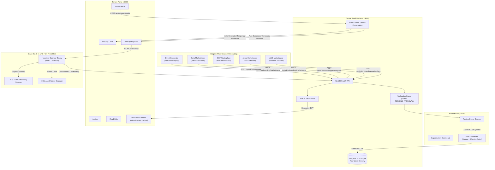
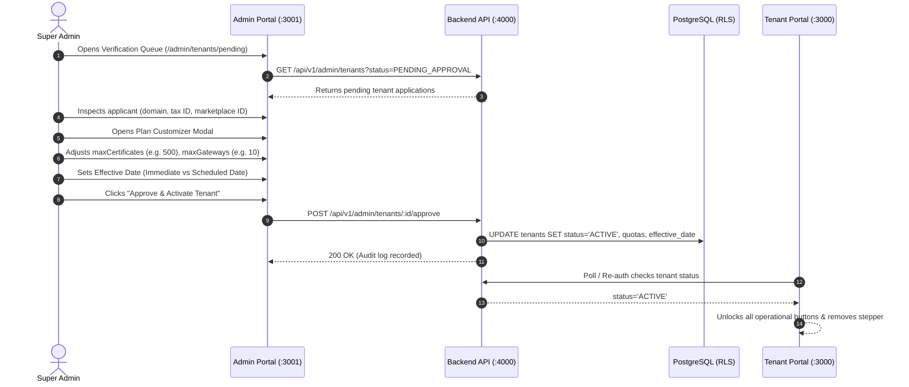
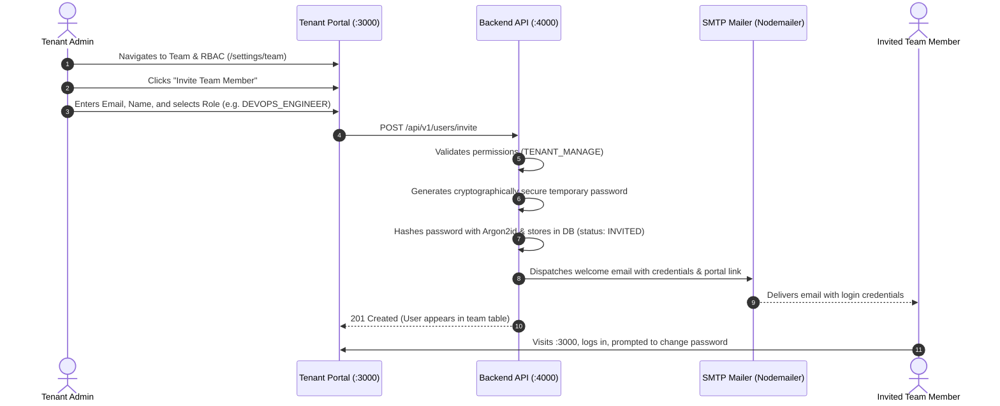
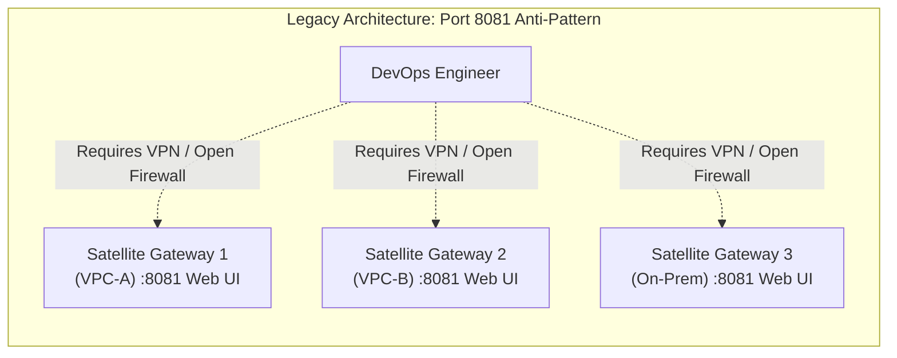
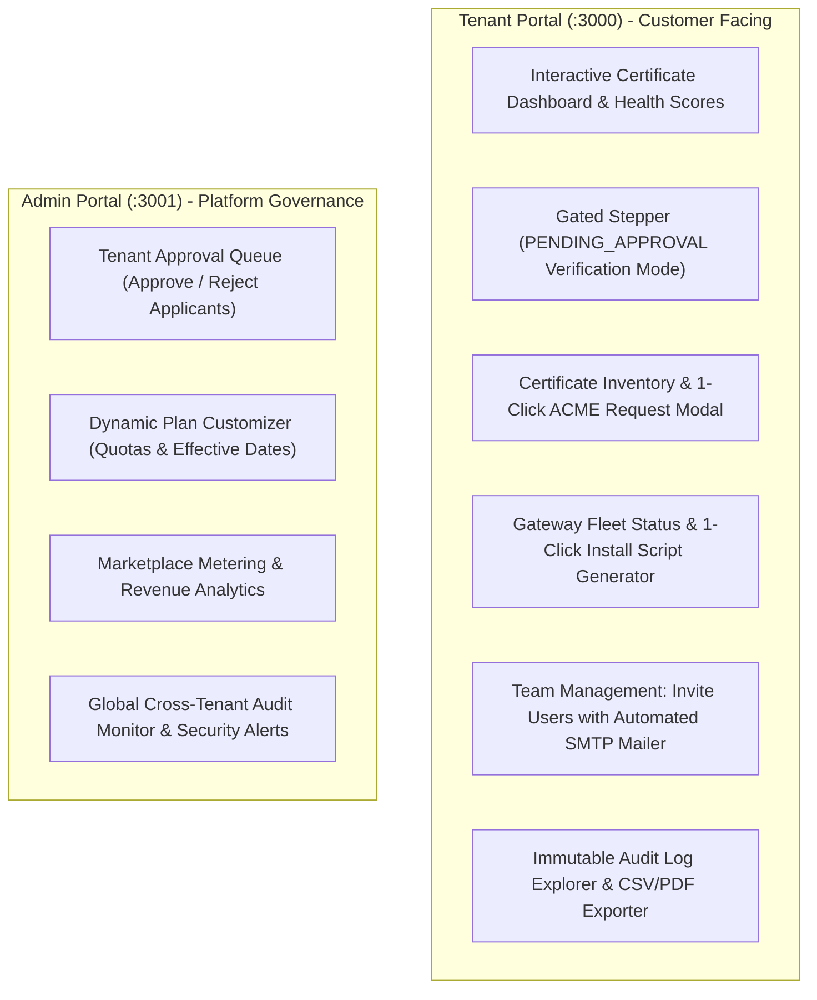
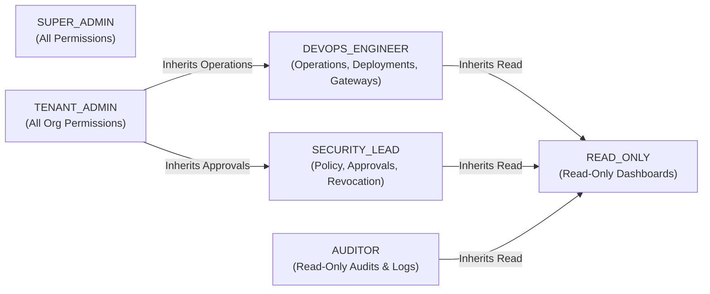
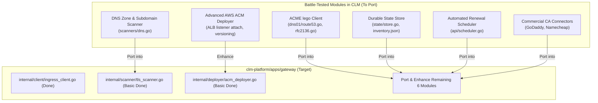
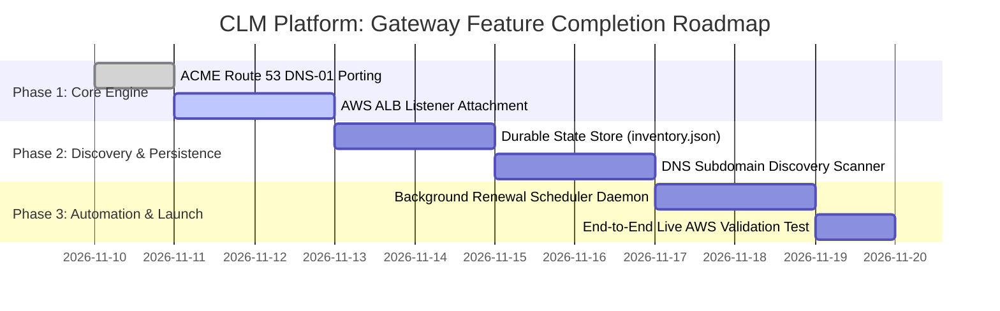

# CLM Platform: Comprehensive Application Comparison & Updated Flow Specification

> **Document Type:** System Architecture, Flow Specification & Comparative Analysis  
> **Reference Systems:** Legacy CLM (`d:\personal\CLM`) vs Modern CLM Platform (`d:\personal\clm-platform`)  
> **Workflow Revision:** 2.1 (Enterprise Production Flow)  
> **Date:** November 10, 2026  
> **Author:** Antigravity Architecture Team

---

## Table of Contents
1. [Executive Summary](#1-executive-summary)
2. [Updated End-to-End System Workflow (with Architecture Diagrams)](#2-updated-end-to-end-system-workflow)
   - [2.1 Stage 1: Multi-Channel Onboarding & Marketplace Ingestion](#21-stage-1-multi-channel-onboarding--marketplace-ingestion)
   - [2.2 Stage 2: Gated Security Verification & Immediate Applicant Login](#22-stage-2-gated-security-verification--immediate-applicant-login)
   - [2.3 Stage 3: Super Admin Plan Customization & Verification Queue](#23-stage-3-super-admin-plan-customization--verification-queue)
   - [2.4 Stage 4: Multi-Gateway Fleet & Zero-Trust Cloud Access Model](#24-stage-4-multi-gateway-fleet--zero-trust-cloud-access-model)
   - [2.5 Stage 5: In-Portal Team RBAC & Automated SMTP Mailer](#25-stage-5-in-portal-team-rbac--automated-smtp-mailer)
   - [2.6 Stage 6: Day-to-Day Discovery, Issuance & Deployment](#26-stage-6-day-to-day-discovery-issuance--deployment)
3. [Deep Portal Comparison: Legacy CLM vs Modern CLM Platform](#3-deep-portal-comparison)
   - [3.1 Portals Matrix & Port Mapping](#31-portals-matrix--port-mapping)
   - [3.2 Why the Legacy Port 8081 Gateway UI Was Flawed](#32-why-the-legacy-port-8081-gateway-ui-was-flawed)
   - [3.3 The New Two-Portal Experience: Separation of Tenant vs Admin](#33-the-new-two-portal-experience-separation-of-tenant-vs-admin)
4. [Role & RBAC Persona Comparison](#4-role--rbac-persona-comparison)
   - [4.1 Role Evolution Matrix (Legacy 10 Roles vs Modern 6 Personas)](#41-role-evolution-matrix)
   - [4.2 Fine-Grained Permissions & Enforcement](#42-fine-grained-permissions--enforcement)
5. [What Was Done Correctly in the New Platform (`clm-platform`)](#5-what-was-done-correctly-in-the-new-platform)
6. [Gap Analysis: What is Missing / Needs Porting from Legacy CLM](#6-gap-analysis-what-is-missing--needs-porting-from-legacy-clm)
   - [6.1 Detailed Technical Gaps in `apps/gateway`](#61-detailed-technical-gaps-in-appsgateway)
   - [6.2 Comparative Feature Parity Table](#62-comparative-feature-parity-table)
7. [Actionable Implementation Roadmap & Porting Checklist](#7-actionable-implementation-roadmap--porting-checklist)

---

## 1. Executive Summary

This document presents a comprehensive comparative analysis between the legacy certificate management system (`d:\personal\CLM`) and the new, enterprise-grade multi-tenant platform (`d:\personal\clm-platform`). 

The objective of building `clm-platform` from scratch was to eliminate architectural bottlenecks, technical debt, and security vulnerabilities present in the legacy codebase—such as monolithic frontend scripts, an insecure on-prem web server model, lack of kernel-level database isolation, and manual onboarding—while preserving and upgrading the battle-tested cryptographic, discovery, and cloud deployment engines developed in the original Go satellite daemon.

The new **CLM Platform** provides an automated, zero-trust control plane that discovers, tracks, auto-renews, and deploys TLS/SSL certificates across public domains, private VPCs, and on-prem networks, backed by true PostgreSQL Row-Level Security (RLS), multi-cloud marketplace billing, and granular RBAC.

---

## 2. Updated End-to-End System Workflow

### High-Level Architecture Flowchart



---

### 2.1 Stage 1: Multi-Channel Onboarding & Marketplace Ingestion

The new platform ingests enterprise tenants through 5 distinct channels:
1. **AWS Marketplace:** Automated token resolution via `ResolveCustomer` API, linking AWS Account ID and Customer Identifier.
2. **Azure Marketplace:** Subscriptions initiated via Azure SaaS fulfillment APIs.
3. **Google Cloud Marketplace:** Procurement account mapping with Cloud Billing.
4. **Zoho Marketplace:** Webhook-driven onboarding for business suites.
5. **Direct Corporate Self-Serve:** Web registration form with company domain, primary contact, and tier selection.

Every registration creates a tenant workspace with status `PENDING_APPROVAL` and initializes the primary user with role `TENANT_ADMIN`.

---

### 2.2 Stage 2: Gated Security Verification & Immediate Applicant Login

In enterprise security, preventing bad actors from issuing certificates for unverified domains is critical.

* **Immediate Access:** Upon completing registration, the user receives an active JWT session and can immediately log into the **Tenant Portal** (`:3000`).
* **Operational Lockout:** The tenant's workspace remains in `PENDING_APPROVAL` status.
* **Gated UI Banner:** The Tenant Portal displays an interactive 3-step verification progress stepper:
  1. *Account Registered & Email Confirmed* (Completed)
  2. *Corporate Security & Compliance Verification* (In Review)
  3. *Production Certificate Issuance Enabled* (Pending)
* **Read-Only / Sandbox Mode:** While pending, dangerous operational buttons (`Issue Certificate`, `Trigger Gateway Scan`, `Enroll Production Gateway`) are safely disabled. Users can explore sample dashboards, read docs, and configure preliminary team settings.

---

### 2.3 Stage 3: Super Admin Plan Customization & Verification Queue

Inside the dedicated **Admin Portal** (`:3001`):



* **Verification Queue:** Super Admins inspect business validity, domain ownership, and marketplace billing contracts.
* **Dynamic Plan Customizer:** Instead of rigid hardcoded tiers, Super Admins can customize quotas (`maxCertificates`, `maxGateways`, retention days, custom rate limits) per tenant.
* **Effective Dates:** Changes can be applied immediately or scheduled for an upcoming billing cycle (e.g., contract renewal on the 1st of next month).
* **Instant Activation:** Once approved, the backend transitions the tenant to `ACTIVE`, which instantly removes the gated banner in the Tenant Portal and unlocks all production certificate operations.

---

### 2.4 Stage 4: Multi-Gateway Fleet & Zero-Trust Cloud Access Model

To manage certificates across air-gapped corporate networks, private AWS VPCs, and on-premises server rooms:

* **Headless Go Daemon:** Unlike the old gateway, the new gateway has **no exposed HTTP/web server** on the customer network.
* **Outbound-Only Ingress:** The gateway establishes outbound secure connections (HTTPS / gRPC) to `https://api.clmplatform.internal/api/v1/gateways/ingress`.
* **Zero Long-Lived Cloud Keys:** In AWS environments, the gateway assumes local EC2/EKS IAM Instance Profiles or IRSA (IAM Roles for Service Accounts) rather than storing static AWS Access Keys in the central database.
* **1-Click Shell Script Enrollment:** DevOps Engineers can copy a single curl command from the Tenant Portal:
  ```bash
  curl -sSL https://get.clmplatform.com/install.sh | bash -s -- --token gw_enroll_token_xyz987 --tags "prod,us-east-1,vpc-main"
  ```

---

### 2.5 Stage 5: Tenant In-Portal Team RBAC Management & Automated SMTP Mailer



* **Self-Contained Organization Management:** Tenant Admins do not need SaaS Super Admin intervention to add or manage their staff.
* **Automated SMTP Delivery:** Nodemailer integration automatically formats and delivers official onboarding emails with temporary login credentials and password reset instructions.
* **Instant Revocation:** Tenant Admins can deactivate or suspend compromised employee accounts with one click.

---

### 2.6 Stage 6: Day-to-Day Discovery, Issuance & Deployment

Once active:
1. **Network & Cloud Discovery:** Gateways scan target VPC subnets (port 443/8443) and AWS ACM inventories, reporting discovered certificates back to the central inventory.
2. **ACME Automated Issuance:** Automated issuance via Let's Encrypt / DigiCert using automated DNS-01 challenges (AWS Route 53 or RFC2136).
3. **Automated Zero-Downtime Deployment:** The gateway deploys issued certificates directly to target endpoints:
   - AWS Certificate Manager (ACM) & Application Load Balancers (ALBs).
   - Local Linux web servers (NGINX, Apache).
   - PostgreSQL / Database TLS listeners.
4. **Expiry Monitoring & Pre-Emptive Renewal:** The platform flags certificates approaching expiration (default: 30 days) and triggers automatic renewal workflows.

---

## 3. Deep Portal Comparison

### 3.1 Portals Matrix & Port Mapping

| Dimension | Legacy CLM (`d:\personal\CLM`) | Modern CLM Platform (`d:\personal\clm-platform`) | Architectural Impact |
| :--- | :--- | :--- | :--- |
| **Number of Web Portals** | **2 Portals** (`admin-portal` + `gateway-ui`) | **2 Portals** (`tenant-portal` + `admin-portal`) | Shifted from "Gateway Local UI" to "Customer Multi-User Tenant Workspace". |
| **Portal 1: Role & Purpose** | `admin-portal` (Port `8080`): Mixed Super Admin & single-tenant controls. | `apps/tenant-portal` (Port `3000`): Dedicated customer workspace for Tenant Admins, DevOps, Security, and Auditors. | Clean separation of customer operations from SaaS platform governance. |
| **Portal 2: Role & Purpose** | `gateway-ui` (Port `8081`): Web UI hosted **locally on each on-prem satellite gateway**. | `apps/admin-portal` (Port `3001`): Dedicated SaaS Super Admin portal for tenant verification, plan customization, and billing. | Centralized control; eliminated local web servers in customer VPCs. |
| **Frontend Framework** | Plain vanilla HTML + monolithic `app.js` (163KB & 199KB vanilla scripts). | **React 18 + TypeScript + Vite + Tailwind CSS + shadcn/ui**. | Component modularity, full type safety, maintainability, responsive design. |
| **Component Library** | Unstructured custom CSS + inline styles. | **shadcn/ui** (Radix UI primitives, Lucide icons, Tailwind). | Enterprise design system, accessible WCAG 2.1 compliance, themeable. |
| **API Client Layer** | Hardcoded `fetch()` calls scattered across `app.js`. | Strongly-typed `@clm/api-client` package with Axios, interceptors, and error handling. | Compile-time verification of request/response payloads. |
| **State Management** | Global window variables and direct DOM manipulation. | React Context, Zustand / React Query hooks with cache invalidation. | Predictable reactive state without race conditions. |
| **Authentication Flow** | Basic HTTP Header / rudimentary session cookie. | **JWT Bearer Authentication** with refresh tokens, Argon2id hashing, and RLS context injection. | Production zero-trust token exchange. |

---

### 3.2 Why the Legacy Port 8081 Gateway UI Was Flawed

In the legacy architecture (`d:\personal\CLM`), every deployed `satellite-gateway` spun up its own local web server hosting `gateway-ui` on port `8081`:



**Critical Flaws of the Legacy Gateway UI Model:**
1. **Severe Security Hole:** Running an HTTP web server inside private subnets violates zero-trust principles. It requires opening ingress firewall rules on port 8081 or exposing internal endpoints.
2. **Operational Nightmare:** If a customer operates 15 VPCs and 5 data centers, engineers had to remember 20 different IP addresses and log into 20 separate local web interfaces.
3. **No Centralized RBAC:** The local gateway UI had no synchronized user management, permission tiers, or centralized audit ledger.
4. **Cross-Site Scripting & Injection Risks:** The 199KB monolithic `app.js` directly injected HTML strings via `innerHTML` without escaping.

**How `clm-platform` Fixed This:**
The modern gateway is **100% headless**. It contains zero HTTP listeners, zero open ports, and zero web interfaces. It connects **outbound** to the central SaaS backend. All configuration, monitoring, and command dispatch happen through the centralized **Tenant Portal** (`:3000`).

---

### 3.3 The New Two-Portal Experience: Separation of Tenant vs Admin



---

## 4. Role & RBAC Persona Comparison

### 4.1 Role Evolution Matrix

| Legacy CLM Role (`d:\personal\CLM`) | Modern `clm-platform` Role | Scope | Key Evolutionary Changes & Fixes |
| :--- | :--- | :--- | :--- |
| `super_admin` | **`SUPER_ADMIN`** | Platform | In the legacy system, `super_admin` could directly view/edit tenant certificates. In `clm-platform`, Super Admins manage tenant lifecycles, plans, and compliance, but **cannot view tenant private keys or decrypt tenant certificates**. |
| `tenant_admin` | **`TENANT_ADMIN`** | Organization | Previously had no ability to invite team members. In `clm-platform`, Tenant Admins have full in-portal team management with automated SMTP credentials dispatch. |
| `admin` | *(Merged into `TENANT_ADMIN`)* | Organization | Legacy had ambiguous overlap between `admin` and `tenant_admin`. Redundant role eliminated. |
| `cert_manager` | **`SECURITY_LEAD`** | Organization | Redefined with explicit cryptographic policy authority: configures approved CAs (DigiCert, Let's Encrypt), enforces minimum key strength (RSA 2048, ECC P-256), and approves certificate revocations. |
| `approver` | *(Merged into `SECURITY_LEAD`)* | Organization | Consolidated duplicate approval logic into `SECURITY_LEAD`. |
| `operator` | **`DEVOPS_ENGINEER`** | Organization | Renamed to industry-standard DevOps role. Can run discovery scans, deploy certificates to ALBs and web servers, and enroll gateway agents. Cannot alter security policies or manage users. |
| `auditor` | **`AUDITOR`** | Organization | Retained with **strict zero-write permissions**. Read-only access to immutable audit trails, inventory, and compliance reporting. |
| `viewer` | **`READ_ONLY`** | Organization | Simplified basic observer tier. In the UI, all destructive and operational action buttons (`Issue`, `Renew`, `Deploy`, `Delete`) are completely hidden. |
| `finance` | *(Integrated into Marketplace Metering)* | Platform / Org | Redundant role replaced by native AWS/Azure/GCP billing integration and usage tracking. |
| `service_account` | *(Replaced by Gateway Ingress Tokens)* | System | Replaced by scoped, cryptographically signed gateway enrollment tokens with mTLS identity. |

---

### 4.2 Fine-Grained Permissions & Enforcement

In `clm-platform`, authorization is strongly typed in `@clm/shared-types` and enforced at both the NestJS API layer (via Guards) and the database layer (via RLS):

```typescript
export enum Permission {
  CERTIFICATE_READ    = 'CERTIFICATE_READ',
  CERTIFICATE_REQUEST = 'CERTIFICATE_REQUEST',
  CERTIFICATE_APPROVE = 'CERTIFICATE_APPROVE',
  CERTIFICATE_REVOKE  = 'CERTIFICATE_REVOKE',
  CERTIFICATE_DEPLOY  = 'CERTIFICATE_DEPLOY',
  GATEWAY_READ        = 'GATEWAY_READ',
  GATEWAY_ENROLL      = 'GATEWAY_ENROLL',
  GATEWAY_MANAGE      = 'GATEWAY_MANAGE',
  TENANT_MANAGE       = 'TENANT_MANAGE',
  USER_MANAGE         = 'USER_MANAGE',
  AUDIT_READ          = 'AUDIT_READ',
}
```



---

## 5. What Was Done Correctly in the New Platform

The new `clm-platform` achieves a generational leap in software architecture, security, and developer ergonomics:

1. **Enterprise Monorepo Architecture:**
   - Unified codebase powered by **pnpm workspaces** and **Turborepo** (`apps/tenant-portal`, `apps/admin-portal`, `apps/backend`, `apps/gateway`, `packages/shared-types`, `packages/api-client`, `packages/ui`, `packages/config`).
   - Shared TypeScript types prevent drift between backend APIs and frontend user interfaces.

2. **Kernel-Level PostgreSQL Row-Level Security (RLS):**
   - The legacy application used standard SQL `WHERE tenant_id = ?` filters in Go code, leaving it vulnerable to accidental developer omissions.
   - `clm-platform` enforces RLS directly in the database engine (`01-init-rls.sql`). The backend sets `SET LOCAL app.tenant_id = :tenantId` on every connection. Even a `SELECT * FROM certificates;` query will physically return *only* the authenticated tenant's data.

3. **True Two-Portal Separation:**
   - `tenant-portal` (`:3000`): Tailored for customer engineering teams with role-based UI pruning.
   - `admin-portal` (`:3001`): Tailored for SaaS operators for verification, quotas, and marketplace governance.

4. **Gated Security Verification (`PENDING_APPROVAL`):**
   - Eliminates rogue certificate generation during signup.
   - Interactive verification stepper keeps applicants informed while restricting production operations until approved.

5. **Dynamic Plan Customizer with Effective Dates:**
   - Super Admins can customize quotas (`maxCertificates`, `maxGateways`) per tenant with immediate or scheduled effective dates, directly addressing enterprise contract requirements.

6. **In-Portal Team RBAC & Automated SMTP Mailer:**
   - Tenant Admins can invite team members (`POST /api/v1/users/invite`).
   - Automated Nodemailer service securely dispatches invitations with temporary credentials.

7. **Headless In-VPC Gateway Client:**
   - Eliminated the vulnerable `:8081` local web server.
   - Gateway acts purely as an outbound agent, preserving the customer's internal perimeter.

8. **Zero Long-Lived Cloud Keys:**
   - Architectural model leverages AWS IAM Instance Profiles / IRSA for cloud deployments rather than storing plaintext AWS IAM credentials in the SaaS database.

9. **Modern Reactive UI Stack:**
   - React 18, Vite, Tailwind CSS, Lucide icons, and shadcn/ui replace 360KB+ of unmaintainable legacy vanilla JavaScript.

10. **Immutable Audit Ledger:**
    - Structured audit events recorded on all state changes (`TENANT_APPROVED`, `CERTIFICATE_ISSUED`, `USER_INVITED`, `GATEWAY_ENROLLED`).

---

## 6. Gap Analysis: What is Missing / Needs Porting from Legacy CLM

While the control plane, database, portals, and backend APIs in `clm-platform` are vastly superior, the legacy Go satellite daemon (`d:\personal\CLM\components\satellite-gateway`) contained several **battle-tested low-level modules** that must be ported into `clm-platform/apps/gateway`.



### 6.1 Detailed Technical Gaps in `apps/gateway`

#### 1. Full ACME Engine with Route 53 DNS-01 Challenges
* **Legacy Implementation:** `satellite-gateway/internal/dns01/route53.go` and `rfc2136.go` using the `go-acme/lego` library. Supported automated TXT record creation, propagation checking, certificate retrieval, and private key generation.
* **Current Status in `clm-platform`:** `apps/gateway` currently lacks the full `lego` integration.
* **Action Required:** Port `dns01/route53.go` and `dns01/rfc2136.go` into `apps/gateway/internal/acme/`.

#### 2. Advanced AWS ACM & ALB Deployer Features
* **Legacy Implementation:** `satellite-gateway/internal/deployment/deployers/cloud/aws_acm.go` supported:
  - Direct ACM import (`ImportCertificate`).
  - ALB listener certificate attachment (`AddListenerCertificates` via AWS ELBv2 SDK).
  - Version policies (`new-version` vs `replace-in-place`).
  - Rollback to previous certificate version upon failure.
* **Current Status in `clm-platform`:** `apps/gateway/internal/deployer/acm_deployer.go` has basic ACM certificate import, but is missing ALB listener attachment and rollback policies.
* **Action Required:** Enhance `acm_deployer.go` with ALB listener targeting and rollback support.

#### 3. DNS Zone & Subdomain Discovery Scanner
* **Legacy Implementation:** `satellite-gateway/internal/discovery/scanners/dns.go` performed zone transfer checks (AXFR), wordlist subdomain brute-forcing, and SRV record resolution to discover untracked internal TLS endpoints.
* **Current Status in `clm-platform`:** `apps/gateway/internal/scanner/tls_scanner.go` only performs port-level TLS handshake checks on provided hostnames.
* **Action Required:** Port the DNS discovery routines from `scanners/dns.go` into `apps/gateway/internal/scanner/dns_scanner.go`.

#### 4. Durable Local State Store & Offline Recovery
* **Legacy Implementation:** `satellite-gateway/internal/state/store.go` maintained an atomic, thread-safe JSON state file (`inventory.json`) and replayable command queue. If the satellite lost internet connectivity, it continued executing local renewal tasks and synchronized with SaaS upon reconnection.
* **Current Status in `clm-platform`:** Gateway operates in-memory; state resets if the daemon process terminates.
* **Action Required:** Port the atomic disk state store into `apps/gateway/internal/state/`.

#### 5. Background Expiration Renewal Cron Scheduler
* **Legacy Implementation:** `satellite-gateway/internal/api/scheduler.go` ran a background goroutine checking for certificates expiring within 30 days and automatically initiating ACME renewal workflows.
* **Current Status in `clm-platform`:** Renewal commands are currently driven by manual trigger or backend-issued jobs.
* **Action Required:** Add an automated background renewal scheduler daemon inside `apps/gateway/internal/scheduler/`.

#### 6. External Commercial CA APIs
* **Legacy Implementation:** `satellite-gateway/internal/ca/godaddy.go` and `namecheap.go` allowed issuing commercial OV/EV certificates via registrar APIs.
* **Current Status in `clm-platform`:** Not yet ported.
* **Action Required:** Port commercial CA adapters into `apps/gateway/internal/ca/`.

---

### 6.2 Comparative Feature Parity Table

| Feature / Capability | Legacy CLM (`CLM`) | Modern Platform (`clm-platform`) | Parity Status | Next Step |
| :--- | :---: | :---: | :---: | :--- |
| **Monorepo & Build Tooling** | ❌ (Scattered makefiles) | ✅ (Turborepo + pnpm) | **Completed** | Modern standard established. |
| **Backend Architecture** | ⚠️ (Go Gin / stdlib) | ✅ (NestJS 10 + Fastify) | **Completed** | Modular, enterprise-grade backend. |
| **Tenant Database Isolation** | ❌ (Application `WHERE`) | ✅ (PostgreSQL 16 RLS) | **Completed** | Kernel-level data separation. |
| **Tenant Portal UI (:3000)** | ❌ (None, only local gateway UI) | ✅ (React 18 + shadcn) | **Completed** | Production customer workspace. |
| **Super Admin Portal (:3001)** | ⚠️ (Vanilla HTML/JS :8080) | ✅ (React 18 + shadcn) | **Completed** | Dedicated SaaS command center. |
| **Gated Verification Stepper** | ❌ (None) | ✅ (Interactive Banner) | **Completed** | Prevents rogue issuance. |
| **Plan Customizer & Effective Dates**| ❌ (Hardcoded plans) | ✅ (Dynamic UI & API) | **Completed** | Per-tenant quotas & dates. |
| **In-Portal Team RBAC + Mailer** | ❌ (Manual DB inserts) | ✅ (Nodemailer + Invite API) | **Completed** | Automated email credentials. |
| **Headless Gateway Ingress** | ❌ (Local :8081 Web UI) | ✅ (Zero-port agent) | **Completed** | Zero-trust architecture. |
| **Network TLS Handshake Scanner**| ✅ (`network.go`) | ✅ (`tls_scanner.go`) | **Completed** | Ported and functional. |
| **Basic AWS ACM Deployer** | ✅ (`aws_acm.go`) | ✅ (`acm_deployer.go`) | **Completed** | Basic import operational. |
| **ACME Route 53 DNS-01 Engine** | ✅ (`route53.go`, `lego`) | ⚠️ (Skeleton only) | **Gap** | **Port `lego` Route 53 to Gateway.** |
| **AWS ALB Listener Attachment** | ✅ (`aws_acm.go`) | ❌ (Not yet implemented) | **Gap** | **Add ELBv2 attachment to Deployer.** |
| **DNS Subdomain Discovery** | ✅ (`dns.go`) | ❌ (Handshake only) | **Gap** | **Port DNS wordlist/AXFR scanner.** |
| **Durable State Persistence** | ✅ (`store.go`, `inventory.json`)| ❌ (In-memory only) | **Gap** | **Add local atomic file store.** |
| **Automated Renewal Scheduler** | ✅ (`scheduler.go`) | ⚠️ (Backend-driven only) | **Gap** | **Add local 30-day cron runner.** |
| **Commercial CA (GoDaddy/Namecheap)**| ✅ (`ca/*.go`) | ❌ (Not yet implemented) | **Gap** | **Port CA connectors if required.** |

---

## 7. Actionable Implementation Roadmap & Porting Checklist



### Immediate Action Items for Gateway Completion:

- [ ] **Task 1: Port ACME Route 53 & RFC2136 (`lego` integration)**
  - Source: `d:\personal\CLM\components\satellite-gateway\internal\dns01\route53.go`
  - Target: `d:\personal\clm-platform\apps\gateway\internal\acme\route53.go`
  - Add `github.com/go-acme/lego/v4` to `apps/gateway/go.mod`.

- [ ] **Task 2: Upgrade ACM Deployer with ALB Listener Binding**
  - Source: `d:\personal\CLM\components\satellite-gateway\internal\deployment\deployers\cloud\aws_acm.go`
  - Target: `d:\personal\clm-platform\apps\gateway\internal\deployer\acm_deployer.go`
  - Add AWS SDK `elbv2.AddListenerCertificates` and version rollback support.

- [ ] **Task 3: Port Durable Atomic State Store**
  - Source: `d:\personal\CLM\components\satellite-gateway\internal\state\store.go`
  - Target: `d:\personal\clm-platform\apps\gateway\internal\state\store.go`
  - Ensures offline resilience and command queue persistence.

- [ ] **Task 4: Port DNS Discovery Scanner**
  - Source: `d:\personal\CLM\components\satellite-gateway\internal\discovery\scanners\dns.go`
  - Target: `d:\personal\clm-platform\apps\gateway\internal\scanner\dns_scanner.go`

- [ ] **Task 5: Implement Automated Renewal Scheduler**
  - Target: `d:\personal\clm-platform\apps\gateway\internal\scheduler\scheduler.go`
  - Periodic 30-day expiration check and automated ACME trigger.

---

## 8. Summary Conclusion

The migration from `d:\personal\CLM` to `d:\personal\clm-platform` successfully modernizes the entire SaaS control plane, replacing legacy security vulnerabilities (insecure local gateway web servers, missing database-level RLS, monolithic JavaScript files) with a production-grade multi-tenant platform.

By completing the porting of the 5 battle-tested gateway modules (ACME Route 53, ALB deployment, DNS scanning, state persistence, and renewal scheduling) into `apps/gateway`, the platform will possess both cutting-edge SaaS management architecture and battle-hardened cloud cryptographic execution capabilities.

