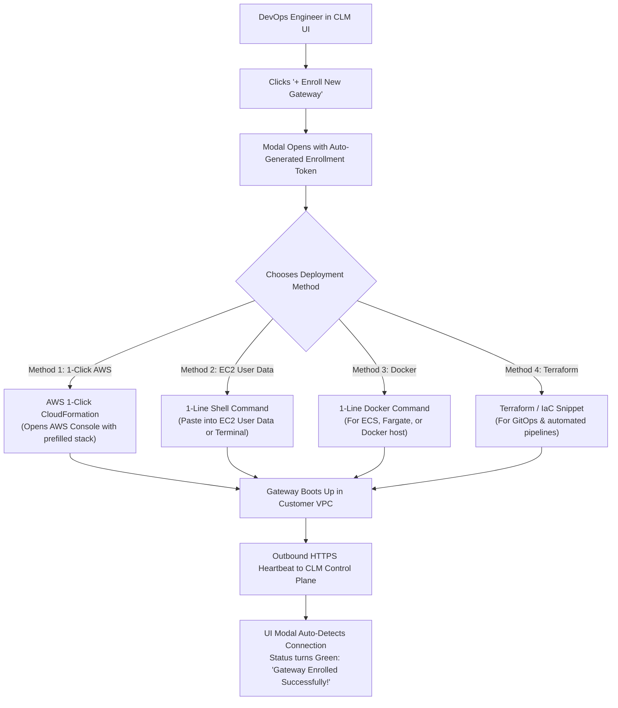

# Satellite Gateway Self-Service Deployment Plan

## 1. Goal & Vision
Transform the Satellite Gateway deployment from a manual terminal/compilation process into an industry-grade, self-service experience in the **Tenant Customer Portal UI**. A customer DevOps engineer should be able to enroll and run an in-VPC gateway in less than 3 minutes through one-click or copy-paste deployment methods.

---

## 2. Target DevOps Experience (UI Workflow)



---

## 3. Phased Implementation Plan

### Phase 1: Robust Bootstrap & Installation Script (`install.sh`)
* **Objective:** Create a bulletproof, automated installation script that any Linux machine or EC2 User Data script can run with zero interaction.
* **Key Deliverables:**
  1. Create `apps/gateway/scripts/install.sh`:
     - Detects OS architecture (`x86_64` / `arm64`).
     - Downloads pre-built satellite gateway binary.
     - Writes configuration to `/etc/clm/gateway.env`.
     - Creates and enables a systemd service (`clm-gateway.service`) with auto-restart on reboot.
     - Immediately starts the daemon and verifies initial outbound beacon.
  2. Add an endpoint in the backend (`/api/v1/ingress/gateway/install.sh`) that serves this script dynamically.

---

### Phase 2: AWS CloudFormation 1-Click Template
* **Objective:** Allow DevOps engineers to launch a gateway into their VPC with zero terminal interaction directly via AWS Console UI.
* **Key Deliverables:**
  1. Create `infra/cloudformation/clm-satellite-gateway.yaml`:
     - **Parameters:** `VpcId`, `SubnetId`, `EnrollmentToken`, `ControlPlaneUrl`, `InstanceType` (default: `t3.micro`).
     - **Resources:**
       - EC2 IAM Role & Instance Profile (with `AWSCertificateManagerFullAccess` and `AmazonSSMManagedInstanceCore`).
       - Outbound-only Security Group (Zero open inbound ports).
       - EC2 Instance with pre-configured User Data running `install.sh`.
  2. Generate a 1-Click AWS Launch URL generator helper:
     ```text
     https://console.aws.amazon.com/cloudformation/home?region=us-east-1#/stacks/create/review?templateURL=...&param_EnrollmentToken=...
     ```

---

### Phase 3: Tenant Portal UI — Interactive Enrollment Modal
* **Objective:** Upgrade the "+ Enroll New Gateway" button in the Tenant Portal into a modern, multi-tab modal with live connection listening.
* **Key Deliverables:**
  1. **Interactive Enrollment Dialog Component (`EnrollGatewayModal.tsx`):**
     - **Tab 1: 1-Click AWS CloudFormation:**
       - Direct "Launch Stack in AWS" button with deep link.
       - Clear step-by-step visual instructions.
     - **Tab 2: EC2 User Data / Linux Terminal:**
       - Pre-filled 1-line command with 1-click "Copy to Clipboard" button.
       - Shows how to paste it into EC2 "User Data" during launch.
     - **Tab 3: Docker & Container:**
       - Ready-to-run `docker run` snippet with environment variables pre-filled.
     - **Tab 4: Terraform / IaC:**
       - Ready-to-copy HCL code block.
  2. **Live Handshake Listener (Real-Time Feedback):**
     - While the modal is open, poll `/api/v1/gateways` every 3 seconds for the newly generated Gateway ID.
     - As soon as the first heartbeat arrives from the VPC, show an animated celebration checkmark: *"Gateway Connected & Active!"* and auto-refresh the dashboard.

---

### Phase 4: Production Containerization & Packaging
* **Objective:** Provide a lightweight official Docker image for teams using Kubernetes, ECS, or Docker Compose.
* **Key Deliverables:**
  1. Minimal multi-stage `Dockerfile` (Scratch or Alpine based, ~15MB image size).
  2. Support passing `CLM_ENROLLMENT_TOKEN` and `CLM_CONTROL_PLANE_URL` as standard container env variables.

---

## 4. Work Breakdown & Timeline

| Phase | Task Description | Scope | Expected Output |
| :--- | :--- | :--- | :--- |
| **Phase 1** | Automated `install.sh` bootstrap script & systemd service | Backend & Gateway Scripts | Zero-touch Linux installation script |
| **Phase 2** | AWS CloudFormation template & 1-Click Launch URL generator | Infrastructure & Backend | 1-Click AWS deployment |
| **Phase 3** | Interactive Enrollment Modal with live handshake detection | Tenant Portal Frontend | Polished, self-service UI experience |
| **Phase 4** | Gateway Dockerfile & container distribution | Gateway Packaging | Container deployment ready |

---

## 5. Verification & Definition of Done
1. A DevOps engineer clicks **"+ Enroll New Gateway"** in the Tenant Portal.
2. The UI instantly generates a secure token and displays the 4 deployment choices.
3. The engineer can either:
   - Click **"Launch Stack in AWS"** and complete it without touching a terminal.
   - Or paste the 1-line script into EC2 User Data.
4. The UI modal automatically detects the instance, closes the modal, and shows the new gateway with a **Green ONLINE** badge.

