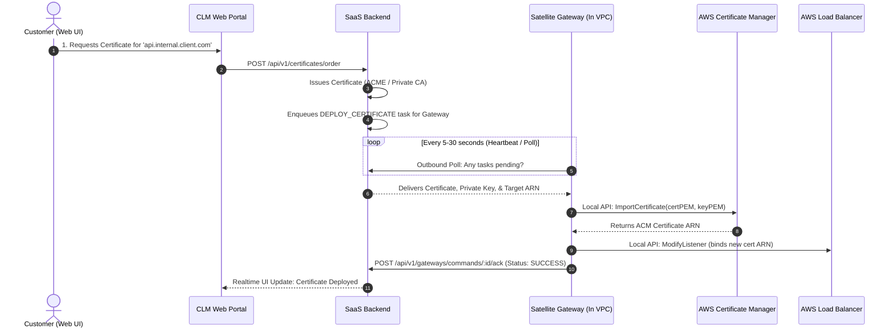

# AWS VPC & Satellite Gateway Architecture & Lifecycle Guide

## 1. Overview & Architecture

The **Satellite Gateway** is a zero-trust, outbound-only daemon deployed inside a customer's private network or AWS VPC. It allows the central CLM SaaS platform to safely manage SSL/TLS certificates and deploy them to internal resources (such as AWS Certificate Manager, private Application Load Balancers, or internal web servers) without requiring any open inbound firewall ports.

### Network Architecture Diagram

```mermaid
flowchart TB
    subgraph ClientBrowser["Client UI Experience"]
        UI["CLM Web Portal (:3000 / :3001)"]
    end

    subgraph SaaS["Central CLM SaaS Platform"]
        API["Backend API & Gateway Ingress (:4000)"]
        QUEUE["Task & Command Queue"]
        DB[("PostgreSQL & Audit Ledger")]
    end

    subgraph CustomerAWS["Customer AWS Environment (Private VPC)"]
        subgraph VPC["Customer VPC"]
            GW["Go Satellite Gateway Daemon<br/>(Runs on EC2 / EKS)"]
            IAM["EC2 IAM Instance Profile<br/>(ACM / ALB Permissions)"]
            ACM["AWS Certificate Manager (ACM)"]
            ALB["Application Load Balancer (ALB)"]
        end
    end

    UI -->|HTTPS / REST| API
    API --> QUEUE
    API --> DB

    GW -->|1. Outbound HTTPS / WSS Poll (Port 443)| API
    GW -->|2. Assumes Local Role| IAM
    GW -->|3. Local Deploy API Calls| ACM
    GW -->|4. Bind Certificate| ALB
```

---

## 2. How the Client Onboards & Places the Gateway via UI

Clients do not need to compile source code or manually install dependencies. The entire workflow is handled through the CLM Web UI and standard AWS Console operations.

### Step 1: Request Gateway Enrollment in the CLM Portal
1. The client logs into the **CLM Customer Portal**.
2. Navigates to **Settings / Gateways** $\rightarrow$ clicks **"Connect New Gateway"**.
3. Enters a friendly name (e.g., `production-aws-vpc`) and selects target support (`AWS ACM / ALB`).
4. The CLM portal generates a unique **Enrollment Token** and a one-line setup command:
   ```bash
   curl -sSL https://get.clm-platform.com/install.sh | bash -s -- --token clm_enroll_xxxxxx
   ```

### Step 2: Provision the EC2 Instance in AWS Console (UI)
1. In the **AWS Management Console**, navigate to **EC2** $\rightarrow$ **Launch Instance**.
2. **Name**: `clm-satellite-gateway`.
3. **Network Settings**:
   - **VPC**: Choose the target VPC (e.g., `clm-satellite-vpc`).
   - **Subnet**: Select a public subnet (or private subnet with an outbound NAT gateway).
   - **Security Group**: Select or create a group with **Zero Inbound Rules** and default outbound traffic allowed (`0.0.0.0/0:443`).
4. **IAM Instance Profile**: Attach an IAM role containing:
   - `AWSCertificateManagerFullAccess`
   - `ElasticLoadBalancingReadOnly` (or `ElasticLoadBalancingFullAccess` if binding certs)
   - `AmazonSSMManagedInstanceCore`
5. **Advanced Details $\rightarrow$ User Data**:
   Paste the one-line installation command provided by the CLM UI.
6. Click **Launch Instance**.

### Step 3: Automatic Enrollment & Handshake
1. As the EC2 instance finishes booting, the User Data script starts the Gateway daemon.
2. The Gateway initiates an **outbound HTTPS connection** to the CLM SaaS Control Plane using the enrollment token.
3. In the CLM Web Portal, the gateway status automatically switches from **`PENDING`** to **`ACTIVE / HEALTHY`** (green badge).

---

## 3. How Certificates are Created & Deployed Inside the VPC



### Detailed Sequence:
1. **Ordering via UI**: The customer submits a certificate request for their internal domain through the portal interface.
2. **Issuance**: The central SaaS control plane validates the domain and obtains the signed public certificate and cryptographic private key.
3. **Task Queuing**: SaaS places a signed deployment command onto the gateway's dedicated queue.
4. **Outbound Pull**: The Satellite Gateway pulls the pending deployment command during its scheduled polling cycle.
5. **Local Deployment**: The Gateway calls the AWS APIs directly within the customer's account using the EC2 instance's IAM role:
   - Imports the certificate into **AWS ACM**.
   - Binds the certificate to the target **ALB Listener** (or updates NGINX configs).
6. **Confirmation**: The Gateway reports success back to the control plane alongside the generated AWS Resource ARN.

---

## 4. How the Client Views and Verifies Certificates

Clients can monitor certificates both within the SaaS interface and inside their native AWS Console:

### A. Inside the CLM Web Portal UI
- **Certificates View**: A real-time inventory listing:
  - **Domain Name**: `api.internal.client.com`
  - **Status**: `Active` (Green indicator)
  - **Deployment Target**: `AWS ACM / ALB` via Gateway `production-aws-vpc`
  - **Validity & Expiry**: Days remaining with automated renewal triggers
  - **Resource ARN**: Direct reference (e.g., `arn:aws:acm:us-east-1:123456789012:certificate/...`)
  - **Audit Logs**: Full audit trail recording when the cert was issued, received by the gateway, and bound.

### B. Inside the AWS Console UI
- **AWS Certificate Manager (ACM)**:
  - Navigate to **ACM Console** in the target AWS Region.
  - The certificate is visible under **Certificates** with status **Issued** and type **Imported**.
- **EC2 / Load Balancers**:
  - Open **EC2** $\rightarrow$ **Load Balancers** $\rightarrow$ select the ALB $\rightarrow$ **Listeners and Rules**.
  - Under HTTPS (Port 443), the imported certificate is active on the listener.

