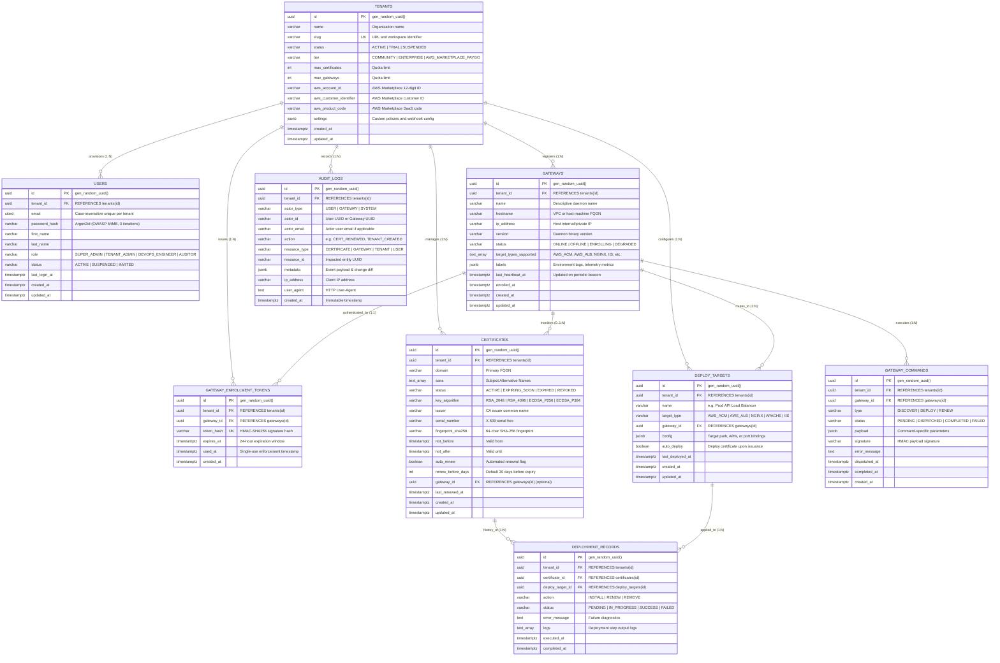

# CLM Platform Database Entity-Relationship (ER) Diagram

This document contains the official database entity-relationship schema for the **Certificate Lifecycle Management (CLM) SaaS Platform**, backed by PostgreSQL 16 with Row-Level Security (RLS) isolation.

---

## 1. Visual Entity-Relationship Diagram

---

## 2. Table Specifications & Security Policies

| Table Name | Partitioning / Scope | Primary Key | Foreign Keys | Key Security Constraints |
|---|---|---|---|---|
| `tenants` | Global Root Entity | `id (UUID)` | None | Unique `slug`, subscription tier & quota tracking |
| `users` | Tenant Scoped | `id (UUID)` | `tenant_id -> tenants(id)` | Argon2id password hash, RLS isolated, unique `(tenant_id, email)` |
| `gateways` | Tenant Scoped | `id (UUID)` | `tenant_id -> tenants(id)` | RLS isolated, mTLS / token authenticated, heartbeat tracked |
| `gateway_enrollment_tokens` | Tenant Scoped | `id (UUID)` | `tenant_id -> tenants(id)`, `gateway_id -> gateways(id)` | Single-use (`used_at IS NULL`), 24h expiration, HMAC-SHA256 hashed |
| `certificates` | Tenant Scoped | `id (UUID)` | `tenant_id -> tenants(id)`, `gateway_id -> gateways(id)` | RLS isolated, SHA-256 fingerprint, automatic renewal policy |
| `deploy_targets` | Tenant Scoped | `id (UUID)` | `tenant_id -> tenants(id)`, `gateway_id -> gateways(id)` | RLS isolated, target configurations (AWS ALB, ACM, NGINX) |
| `deployment_records` | Tenant Scoped | `id (UUID)` | `certificate_id`, `deploy_target_id` | RLS isolated, execution logs, failure diagnostics |
| `gateway_commands` | Tenant Scoped | `id (UUID)` | `tenant_id -> tenants(id)`, `gateway_id -> gateways(id)` | RLS isolated, HMAC signed command payloads, execution state machine |
| `audit_logs` | Tenant Scoped | `id (UUID)` | `tenant_id -> tenants(id)` | **Append-only enforced** (`no_update_audit_logs`, `no_delete_audit_logs`), RLS isolated |

